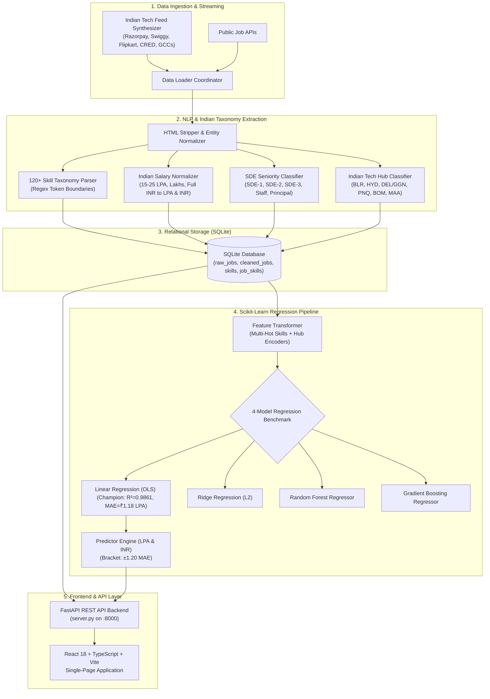

# 🇮🇳 Indian Tech Market Intelligence & Salary Prediction Platform (2025 – 2026)

[](https://www.python.org/)
[](https://react.dev/)
[](https://fastapi.tiangolo.com/)
[](https://scikit-learn.org/)
[](https://www.sqlite.org/)
[]()

An end-to-end data intelligence and machine learning platform specifically engineered for the **Indian Tech Ecosystem (2025–2026)**. The platform extracts, cleanses, and parses unstructured job market listings, tracks high-demand technical competencies across Indian Tech Hubs (*Bengaluru, Hyderabad, Pune, Delhi NCR, Mumbai, Chennai*), analyzes compensation in **Lakhs Per Annum (LPA)** and **INR (₹)**, and estimates realistic compensation brackets with marginal skill valuations via machine learning regression models.

---

## 🏛️ System Architecture



---

## 🌟 Core Highlights & Capabilities

### 1. ⚛️ Modern React Single-Page Application (`frontend/`)
- Built with **React 18**, **TypeScript**, **Vite**, and **Lucide Icons**.
- **Market Dynamics Dashboard**: Real-time KPI summary, interactive hub/role filters, top 20 skills ranking with color intensity bars, and SDE tier ladder.
- **ML Salary Predictor**: Interactive sliders and categorized skill selector (*AI/ML, Backend, Cloud/DevOps, Data, Frontend, Security*) with instant CTC bracket and marginal skill valuations.
- **Active Postings Explorer**: Live searchable and filterable database of cleansed Indian tech listings.
- **Real-Time Stream Trigger**: Ingest new postings into SQLite on the fly with automatic dashboard refresh.
- **Interactive SQL Console**: Execute custom or preset analytical SQL queries with live table rendering.

### 2. ⚡ Unified FastAPI REST Backend (`server.py`)
- High-performance asynchronous API server providing 10+ REST endpoints.
- Auto-mounts the compiled React distribution (`frontend/dist/`), serving both the application UI and REST APIs from a single entry point (`http://localhost:8000`).

### 3. 🇮🇳 Tailored for the Indian Tech Ecosystem
- **Dual-Unit Compensation**: Full native support for **Lakhs Per Annum (LPA)** and **Indian Rupee (₹ INR)**.
- **6 Tier-1 Indian Tech Hubs**:
  - **Bengaluru (Bangalore)**: Product Unicorns, AI research, and high-concurrency systems.
  - **Hyderabad**: Global Capability Centers (GCCs) & Enterprise Cloud giants (*Microsoft, Amazon, Google, Salesforce*).
  - **Delhi NCR (Gurgaon / Noida)**: Quick-commerce, consumer tech, and fintech scale-ups (*Zomato, Blinkit, Adobe*).
  - **Pune**: SaaS, platform engineering, and automotive tech.
  - **Mumbai**: Fintech, algorithmic trading (HFT), and banking technology (*Zepto, BrowserStack*).
  - **Chennai**: Enterprise SaaS capital (*Freshworks, Zoho*) and systems infrastructure.
  - **Remote (India)**: Pan-India flexible remote roles.
- **SDE Seniority Mapping**: Automated recognition of **SDE-1 / Fresher (0-2 yrs)**, **SDE-2 / Mid-Level (3-5 yrs)**, **SDE-3 / Senior (6-8 yrs)**, **Lead / Staff / EM (9-12 yrs)**, and **Principal / Director (12+ yrs)**.

### 4. 🤖 Machine Learning Regression Baselines (in LPA)
Evaluated on validated Indian market listings using an 80/20 train/test split:

| Model Baseline | MAE (₹ LPA) | RMSE (₹ LPA) | $R^2$ Score | Median APE (%) | Bracket Coverage ($\pm 1.2 \times \text{MAE}$) |
| :--- | :---: | :---: | :---: | :---: | :---: |
| **Linear Regression (OLS) (Champion)** | **₹1.18 LPA** | **₹1.46 LPA** | **0.9861** | **3.92%** | **78.33%** |
| **Random Forest Regressor** | ₹1.18 LPA | ₹1.60 LPA | 0.9832 | 3.84% | 77.50% |
| **Ridge Regression ($L_2$)** | ₹1.26 LPA | ₹1.60 LPA | 0.9833 | 4.28% | 78.33% |
| **Gradient Boosting Regressor** | ₹1.27 LPA | ₹1.75 LPA | 0.9800 | 4.41% | 78.33% |

---

## 📁 Repository Structure

```
Job Market Intelligence & Salary Prediction Platform/
├── frontend/                      # Modern React Single-Page Application
│   ├── src/
│   │   ├── App.tsx                # Main Interactive React Component (Dashboard, ML Predictor, Jobs, SQL)
│   │   ├── main.tsx               # React DOM root entry
│   │   └── index.css              # Custom responsive styling and design system
│   ├── dist/                      # Pre-compiled standalone React bundle (Zero-setup deployment)
│   ├── package.json               # Frontend dependencies (React, Vite, Lucide React)
│   └── vite.config.ts             # Vite configuration with API reverse proxy
├── server.py                      # FastAPI REST Backend & static asset server (:8000)
├── app.py                         # Alternative Streamlit Web Dashboard (:8501)
├── main.py                        # CLI pipeline runner (Ingestion -> NLP -> SQL -> ML -> Charts)
├── requirements.txt               # Python dependencies
├── README.md                      # Platform documentation
├── data/
│   └── job_market.db              # SQLite Relational Database (3NF)
├── artifacts/
│   ├── figures/                   # Publication-quality 300 DPI Matplotlib PNGs
│   │   ├── compensation_dynamics_tier.png
│   │   ├── high_demand_skills.png
│   │   ├── ml_baselines_comparison.png
│   │   ├── regional_compensation_scales.png
│   │   └── supply_demand_matrix.png
│   └── models/                    # Trained champion model & transformer
│       ├── champion_salary_model.joblib
│       ├── feature_transformer.joblib
│       └── model_benchmark.json
├── src/
│   ├── ingestion/
│   │   ├── api_clients.py         # Live HTTP job API clients
│   │   ├── synthetic_stream.py    # Indian market feed synthesizer
│   │   └── data_loader.py         # Ingestion coordinator & bulk database loader
│   ├── nlp/
│   │   ├── taxonomy.py            # Master taxonomy: 120+ skills & 6 Indian Tech Hubs
│   │   ├── parser.py              # Text cleansing, regex skill NER, SDE seniority parsing
│   │   └── salary_extractor.py    # Unstructured LPA, Lakhs, CTC, and INR normalizer
│   ├── database/
│   │   ├── schema.sql             # SQL schema (LPA & INR columns, relational join tables)
│   │   └── db_manager.py          # SQLite manager & analytical queries
│   ├── models/
│   │   ├── feature_engineering.py  # Multi-hot skill & categorical feature pipeline
│   │   ├── train_models.py        # 4 Regression baselines training & benchmark
│   │   ├── evaluation.py          # Metrics: MAE, RMSE, R², MedAPE, bracket coverage
│   │   └── predictor.py           # Real-time bracket estimator (±1.20 MAE in LPA & INR)
│   └── visualization/
│       └── charts.py              # Matplotlib visualizer formatting axes in ₹ LPA
└── tests/
    └── test_platform.py           # Unit tests validating LPA parser, Indian hubs, and SDE seniority
```

---

## ⚡ Quick Start Guide

### 1. Installation
Clone the repository and install the Python dependencies:
```bash
git clone https://github.com/naivedhjariwala/job-market-intelligence-india.git
cd job-market-intelligence-india
pip install -r requirements.txt
```

### 2. Run the Data & ML Pipeline
Ingest Indian tech listings, run NLP feature extraction, train regression baselines, and generate Matplotlib figures:
```bash
python main.py
```

### 3. Launch the React Web Application
Run the FastAPI server, which hosts both the REST API and the pre-built React frontend:
```bash
python server.py
```
👉 Open your browser at **[http://localhost:8000](http://localhost:8000)**.

### 4. (Optional) Run Frontend in Development Mode
If modifying the React source code:
```bash
cd frontend
npm install
node "node_modules/vite/bin/vite.js"
```
👉 Open Vite dev server at **[http://localhost:5173](http://localhost:5173)**.

### 5. Run Automated Tests
Execute the pytest suite to verify NLP parsing, Indian salary extraction, SQLite operations, and model inference:
```bash
python -m pytest tests/test_platform.py -v
```

---

## 🔌 REST API Endpoints Reference

| Method | Endpoint | Description |
| :--- | :--- | :--- |
| `GET` | `/api/overview` | Core KPIs: Total listings, median CTC (LPA & INR), remote %, #1 skill |
| `GET` | `/api/metadata` | Static metadata: Tech hubs, job families, experience tiers, skill taxonomy |
| `GET` | `/api/top-skills?limit=20` | Top 20 demanded technical skills with average LPA and INR |
| `GET` | `/api/compensation-by-tier` | SDE experience tier ladder with min, median, and max LPA |
| `GET` | `/api/compensation-by-hub` | Regional compensation across Bengaluru, Hyderabad, Pune, Delhi NCR, etc. |
| `GET` | `/api/supply-demand-matrix` | 2D matrix of Job Families vs Experience Tiers in LPA |
| `GET` | `/api/jobs` | Searchable, paginated Indian job listings with hub and role filters |
| `POST` | `/api/predict-salary` | ML inference returning realistic CTC bracket in LPA & INR + skill premiums |
| `POST` | `/api/ingest-stream` | Stream incremental active job listings into SQLite |
| `POST` | `/api/sql-query` | Execute arbitrary analytical SQL query against the database |
| `GET` | `/api/benchmark` | Regression baseline benchmark metrics (MAE, RMSE, $R^2$, MedAPE) |

---

## 🎯 Sample Real-World Indian Tech Predictions

```
1. Senior AI / LLM Engineer (Bengaluru / Bangalore)
   - Skills: Python, PyTorch, LLMs / Generative AI, RAG, Kubernetes
   - Estimated Bracket: ₹24.9 – ₹27.7 LPA (₹24,90,000 – ₹27,70,000 INR)
   - Predicted Median:  ₹26.3 LPA

2. Lead / Staff Distributed Systems Engineer (Hyderabad, Remote)
   - Skills: Go (Golang), PostgreSQL, Kubernetes, Apache Kafka, Docker, Microservices
   - Estimated Bracket: ₹45.1 – ₹48.0 LPA (₹45,10,000 – ₹48,00,000 INR)
   - Predicted Median:  ₹46.6 LPA (Skill Valuation Addition: +₹3.6 LPA)

3. Mid-Level / SDE-2 Full Stack Engineer (Pune, On-Site)
   - Skills: TypeScript, React, Next.js, Node.js, PostgreSQL
   - Estimated Bracket: ₹15.1 – ₹18.0 LPA (₹1,510,000 – ₹1,800,000 INR)
   - Predicted Median:  ₹16.5 LPA
```

---

## 📄 License
This project is open source and available under the [MIT License](LICENSE).
